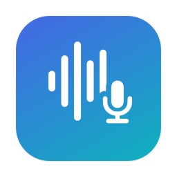
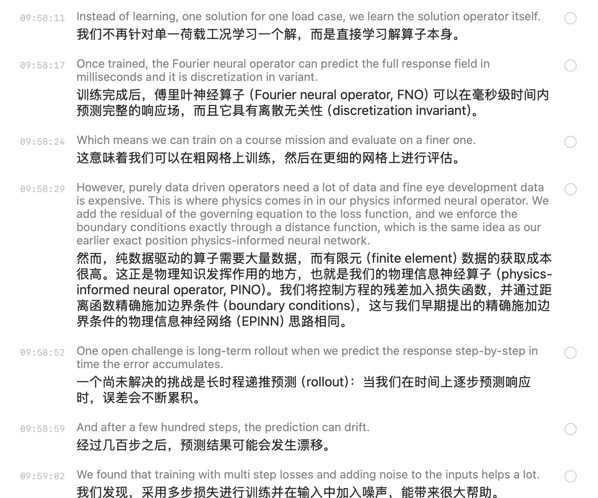

<p align="center"></p>

<h1 align="center">讲座助手 · Lecture Assistant</h1>

<p align="center">
听学术讲座时用的 macOS 应用：实时转写、英译中、自动总结、选句解惑、准备提问，记录自动存进 Obsidian。<br>
A native macOS app for academic talks: live transcription, English→Chinese translation, rolling summaries, ask-AI-about-this-sentence, and question prep — all saved to Obsidian.
</p>

<p align="center"><a href="#中文">中文</a> · <a href="#english">English</a></p>

<p align="center"></p>

---

## 中文

### 功能

- **实时转写**：用系统自带的离线听写模型识别中文或英文，音频不出本机。按音量检测说话停顿、主动断句，一般 4–15 秒定稿一句。
- **英译中 / 中文纠错**：英文讲座每句下面出中文翻译；中文讲座自动纠正同音错字和术语（只改读音相近的字词），识别原文一直保留。
- **自动总结**：每隔几分钟总结新内容，更新整场摘要，并列出和你的研究相关的点。
- **选句解惑**：点选听不懂的句子（可多选）问 AI。它结合讲座上下文、你的背景和 Obsidian 笔记库里检索到的笔记来解释，还会给出可以追问的问题。可选联网搜索。
- **准备提问**：生成 6 个问题，每个都有中英文问法、为什么值得问、对方可能怎么答。被点名时按 ⌘J，十秒左右给你一个能直接开口的问题和一句自我介绍。
- **本地存档**：Markdown 记录（摘要、问答、问题、完整转写）自动保存到 Obsidian，录音同时存成 m4a；应用意外退出后重开会恢复。

### 环境要求

- macOS 26 或更高版本（用到 SpeechAnalyzer），建议 Apple Silicon
- Swift 6.2 以上工具链（Xcode 26，或只装 Command Line Tools 也行）
- Anthropic Messages API 的 key（官方或兼容的中转都可以），或者 OpenAI 兼容接口
- 在 系统设置 › 键盘 › 听写 里装好要用的语言

### 安装

```bash
git clone https://github.com/fhy12130-afk/lecture-assistant.git
cd lecture-assistant
./build.sh --install
```

构建出来的是 `build/讲座助手.app`，加 `--install` 会复制到 `/Applications`。应用是 ad-hoc 签名，第一次打开如果被系统拦住，在访达里右键 › 打开。

### 配置

1. **API key**：存成一个只放 key 的文件，默认路径是 `~/.config/lecture-assistant/key`（建议 `chmod 600`）；也可以在设置里直接粘贴。
2. **设置 › AI 接口**：填地址（默认 `https://api.anthropic.com`）、接口格式和模型（默认 `claude-opus-5-5`），点「测试连接」确认能用。
3. **设置 › 我的资料**：写上你的背景、主讲人信息、每次都要带上的笔记（相对 vault 的路径）和提问侧重点。写得越具体，解惑和提问越贴合你。
4. **设置 › 存储**：Obsidian vault 的路径，以及记录和录音放在哪个文件夹。

想让个人信息不进代码，可以把它们写进 `~/Library/Application Support/LectureAssistant/preset.json`，格式见 [`preset.example.json`](preset.example.json)。应用启动时会读这个文件；设置里的「恢复默认内容」也会回到它。

### 使用

1. 在顶部选讲座语言（「中文」或「英文 → 中文」），点「开始」（⌘R）。第一次会请求麦克风和「文稿」文件夹权限。
2. 听不懂的句子点一下，再点「直接问 AI」（⌘↩）；也可以在右侧「疑问」里写下具体问题。
3. 右侧「提问」页里点「生成问题清单」；被点名时按 ⌘J。
4. 换下一场讲座时按 ⌘N 新建记录。已有的录音可以从「更多 › 导入录音文件转写」导入。

### 隐私

- 语音识别全部在本机完成，录音不会上传。
- 发给你配置的 AI 接口的内容有：转写文字、你的背景、主讲人信息、检索到的笔记片段。
- key 只从你指定的文件里读，不会写进代码或设置。

### 自测

不开界面也能跑完整条流程（识别 → 翻译或纠错 → 总结 → 检索解惑 → 提问 → 写 Markdown），结果只写到 `--out` 指定的目录：

```bash
say -v Samantha -o /tmp/en.aiff "Today I will talk about neural operators as surrogate models for finite element analysis."
/Applications/讲座助手.app/Contents/MacOS/LectureAssistant --selftest /tmp/en.aiff --lang en --out /tmp/selftest
```

可选参数：`--live 1` 按实时速度把音频当麦克风输入；`--full` 同时生成问题清单；`--web` 解惑时允许联网搜索。

### 已知限制

- 新的长语音模型 SpeechTranscriber 在部分机器上英文模型的下载请求一直不返回，所以统一用听写模型 DictationTranscriber。
- 听写模型要停顿很久才会自己定稿，所以应用用音量检测停顿来主动断句；会场很吵或回声大时，断句和识别都会变差。
- 中文纠错偶尔会把术语改错，原始识别文本始终保留在下面。
- 目前只支持中文和英文。

### 代码结构

| 文件 | 内容 |
|---|---|
| `SpeechEngine.swift` | 麦克风采集、格式转换、SpeechAnalyzer、停顿断句、录音 |
| `LLMClient.swift` | Anthropic / OpenAI 兼容接口：流式输出、联网搜索、拒答时换模型重试 |
| `Assistant.swift` | 翻译、纠错、总结、检索关键词、解惑、提问的提示词 |
| `VaultSearch.swift` | Obsidian 笔记全文检索 |
| `SessionStore*.swift` | 会话状态、自动保存、AI 任务调度 |
| `ContentView.swift` 等 | SwiftUI 界面 |
| `SelfTest.swift` | 无界面自测 |

---

## English

### Features

- **Live transcription** with macOS's on-device dictation model (Chinese or English); audio never leaves your Mac. The app detects pauses from the audio level and finalizes sentence by sentence, usually every 4–15 seconds.
- **Translation / correction**: English talks get a Chinese translation under each sentence. Chinese talks get homophone and terminology fixes (only sound-alike substitutions); the raw transcript is always kept.
- **Rolling summaries**: every few minutes the new part is summarized, the whole-talk summary is updated, and points relevant to your own research are listed.
- **Ask about a sentence**: tap the sentences you didn't follow and ask the AI. It answers using the talk context, your profile, and notes retrieved from your Obsidian vault, and suggests follow-up questions. Web search is optional.
- **Question prep**: six questions, each with Chinese and English wording, why it's worth asking, and a likely answer. Press ⌘J when you're called on to get one ready-to-say question plus a one-line self-introduction in about ten seconds.
- **Local archive**: a Markdown record (summaries, Q&A, questions, full transcript) is saved to Obsidian as you go, along with an m4a recording. The session is restored if the app quits unexpectedly.

### Requirements

- macOS 26 or later (SpeechAnalyzer); Apple Silicon recommended
- Swift 6.2+ toolchain (Xcode 26 or just the Command Line Tools)
- An Anthropic Messages API key (official or a compatible proxy), or an OpenAI-compatible endpoint
- The languages you need installed under System Settings › Keyboard › Dictation

### Install

```bash
git clone https://github.com/fhy12130-afk/lecture-assistant.git
cd lecture-assistant
./build.sh --install
```

This builds `build/讲座助手.app`; `--install` copies it to `/Applications`. The app is ad-hoc signed, so if macOS blocks the first launch, right-click it in Finder and choose Open.

### Configure

1. **API key**: put the key alone in a file, by default `~/.config/lecture-assistant/key` (`chmod 600` recommended), or paste it in Settings.
2. **Settings › AI**: endpoint (default `https://api.anthropic.com`), API format, and models (default `claude-opus-5-5`). Click "测试连接" (Test connection).
3. **Settings › Profile**: your background, the speaker's background, notes to always include (paths relative to the vault), and the angles you want your questions to take. The more specific, the better the answers and questions fit you.
4. **Settings › Storage**: Obsidian vault path and the folders for records and recordings.

To keep personal details out of the code, put them in `~/Library/Application Support/LectureAssistant/preset.json` (see [`preset.example.json`](preset.example.json)). It is read at launch, and "恢复默认内容" (restore defaults) in Settings goes back to it.

### Use

1. Pick the talk language at the top ("中文" or "英文 → 中文") and press Start (⌘R). The first run asks for microphone and Documents-folder access.
2. Tap a sentence you didn't follow, then "直接问 AI" (⌘↩), or type a specific question in the 疑问 (Questions) tab.
3. In the 提问 (Ask) tab, generate a question list; press ⌘J when you're called on.
4. Press ⌘N to start a new record for the next talk. Existing recordings can be transcribed via More › Import audio.

### Privacy

- Speech recognition runs entirely on device; audio is never uploaded.
- What goes to your configured AI endpoint: transcript text, your profile, the speaker profile, and retrieved note snippets.
- The key is only read from the file you point to; it is never written into code or settings.

### Self-test

Runs the whole pipeline without UI (ASR → translation/correction → summary → retrieval Q&A → questions → Markdown) and writes only to `--out`:

```bash
say -v Samantha -o /tmp/en.aiff "Today I will talk about neural operators as surrogate models for finite element analysis."
/Applications/讲座助手.app/Contents/MacOS/LectureAssistant --selftest /tmp/en.aiff --lang en --out /tmp/selftest
```

Options: `--live 1` feeds the file at real-time speed through the microphone path; `--full` also generates the question list; `--web` allows web search during Q&A.

### Known limitations

- On some machines the English model download for the newer SpeechTranscriber never completes, so the app uses DictationTranscriber for both languages.
- The dictation model waits for long pauses before finalizing, so the app finalizes on detected pauses; noisy or echoey rooms degrade both segmentation and recognition.
- Chinese correction occasionally changes a term wrongly; the raw transcript stays visible.
- Chinese and English only, for now.

### Layout

| File | What it does |
|---|---|
| `SpeechEngine.swift` | Mic capture, format conversion, SpeechAnalyzer, pause-based finalization, recording |
| `LLMClient.swift` | Anthropic / OpenAI-compatible client: streaming, web search, retry on refusal with another model |
| `Assistant.swift` | Prompts for translation, correction, summaries, search keywords, Q&A, questions |
| `VaultSearch.swift` | Full-text search over the Obsidian vault |
| `SessionStore*.swift` | Session state, autosave, AI task scheduling |
| `ContentView.swift` etc. | SwiftUI interface |
| `SelfTest.swift` | Headless self-test |

## License

[MIT](LICENSE)
